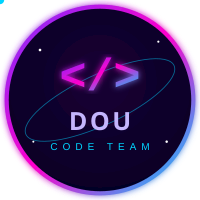
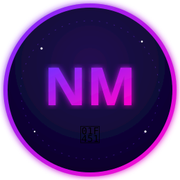
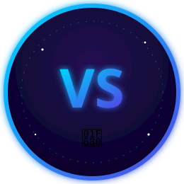
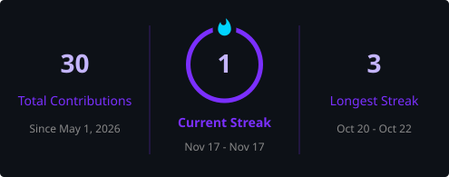

 

 

&nbsp;
&nbsp;
&nbsp;

 

 

> 🏆 **Our mission: the Project of the Year** &nbsp;·&nbsp; 🌌 Full-Stack Development &nbsp;·&nbsp; ⚡ Plan. Design. Build. Launch.

 

  <b>Dou Code Team</b> is a full-stack development team formed in <b>2026</b> with one clear target:
  to build the <b>Project of the Year</b>. Two developers, one shared vision — we design, code,
  and ship complete products from the interface to the database.  
  Small team, big orbit — <i>we code, we create, we aim for the stars.</i>

 

 

<table>
  <tr>
    <td align="center" width="50%">
      
        
      <b>✨ Nak Marozash</b>
       
      👑 Team Leader
       
      💻 Full-Stack Developer
        
      
    </td>
    <td align="center" width="50%">
      
        
      <b>✨ Vey Sovann</b>
       
      🚀 Founder
       
      💻 Full-Stack Developer
        
      
    </td>
  </tr>
</table>

 

 

&nbsp;&nbsp;

  

  

 

 

<table>
<tr>
<td align="center" valign="top" width="50%">

**🎨 Frontend**

</td>
<td align="center" valign="top" width="50%">

**⚙️ Backend**

</td>
</tr>
<tr>
<td align="center" valign="top" width="50%">

**🗄️ Databases**

</td>
<td align="center" valign="top" width="50%">

**🛠️ Tools &amp; Deploy**

</td>
</tr>
</table>

 

 

<table>
  <tr>
    <td align="center">
       
      
        
      <b><i>"Great software is built by a team that never stops learning."</i></b>
        
    </td>
  </tr>
</table>

 

 

<table>
  <tr>
    <td align="center" width="20%">
      
        
      🧭
       
      <b>PLAN</b>
        
      Turn a big idea into a clear scope, goals, and milestones
    </td>
    <td align="center" width="20%">
      
        
      🎨
       
      <b>DESIGN</b>
        
      Craft clean, modern, and user-friendly interfaces
    </td>
    <td align="center" width="20%">
      
        
      ⚙️
       
      <b>BUILD</b>
        
      Develop solid front-end, back-end, and database features
    </td>
    <td align="center" width="20%">
      
        
      🛡️
       
      <b>TEST</b>
        
      Fix bugs, polish details, and make it reliable
    </td>
    <td align="center" width="20%">
      
        
      🚀
       
      <b>LAUNCH</b>
        
      Ship the project and show it to the world
    </td>
  </tr>
</table>

 

 

  

<table>
  <tr>
    <th>When</th>
    <th>Stage</th>
    <th>What happens</th>
  </tr>
  <tr>
    <td align="center"><b>Q1 2026</b></td>
    <td align="center">🌱 Team founded</td>
    <td>Dou-Code-Team is born; stack and tools chosen</td>
  </tr>
  <tr>
    <td align="center"><b>Q2 2026</b></td>
    <td align="center">🧭 Plan &amp; design</td>
    <td>Idea, scope, wireframes, and UI style locked in</td>
  </tr>
  <tr>
    <td align="center"><b>Q3 2026</b></td>
    <td align="center">⚙️ Build</td>
    <td>Front-end, back-end, and database come together</td>
  </tr>
  <tr>
    <td align="center"><b>Q4 2026</b></td>
    <td align="center">🚀 Launch</td>
    <td>Test, polish, and present our Project of the Year</td>
  </tr>
</table>

 

 

 

 

### ⭐ If you like our work, give us a star!

 

_🌌 Together we code the universe. &nbsp;·&nbsp; 🚀 Dou Code Team — Since 2026_

 

&nbsp;
&nbsp;

  

